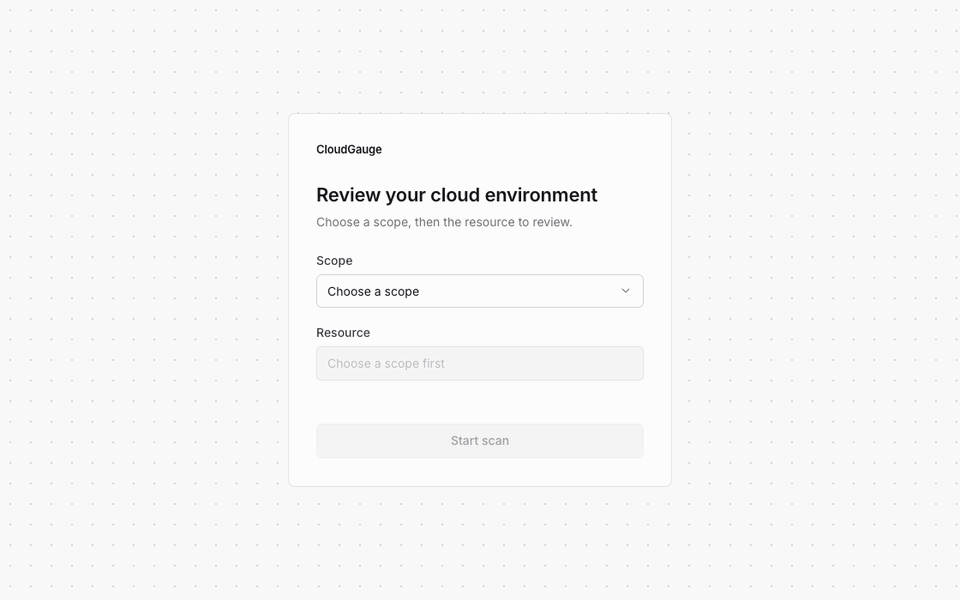
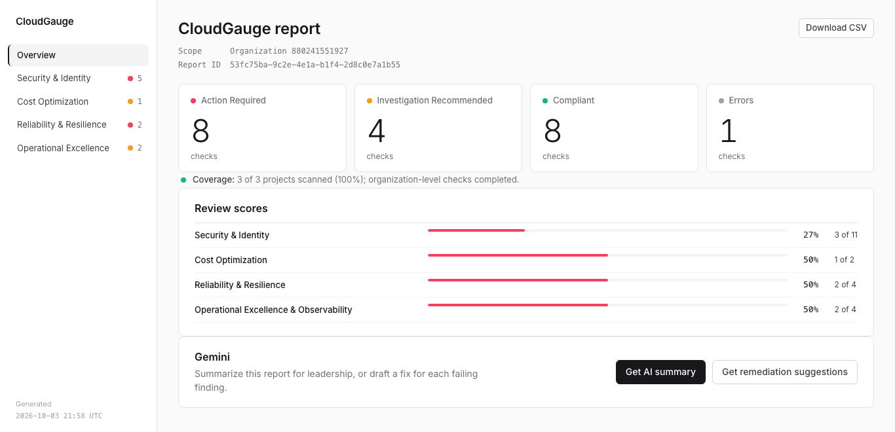
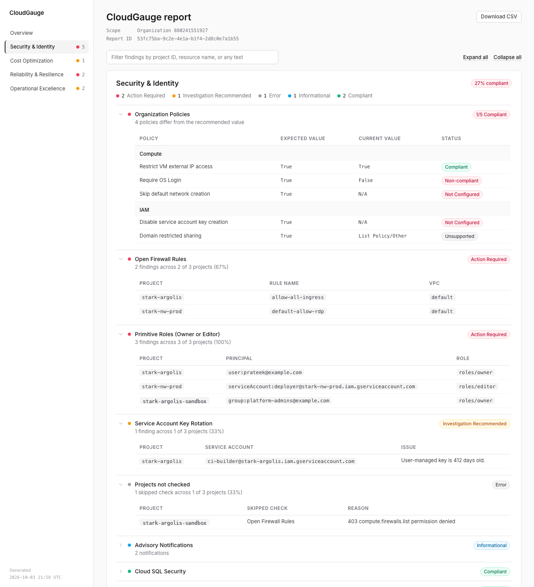

[](LICENSE)
[](https://github.com/GoogleCloudPlatform/CloudGauge/actions/workflows/ci.yml)
[](https://github.com/GoogleCloudPlatform/CloudGauge/releases)

# **CloudGauge**

**Note:** This is not an officially supported Google product. This project is not eligible for the [Google Open Source Software Vulnerability Rewards Program](https://bughunters.google.com/open-source-security).

CloudGauge is a web application designed to run a comprehensive set of compliance, security, cost optimization, and best-practice checks against a Google Cloud **organization, folder or project**.

It is built with Python/Flask, structured as a modular application package (Flask *application factory*), and deployed as a serverless application on **Google Cloud Run**. The application leverages **Cloud Tasks** to run scans asynchronously — a large organization is split into shards that run in parallel — ensuring that even very large organizations can be scanned without browser timeouts.

Final results are delivered as an interactive **HTML report** (an Overview, a one-page **Scorecard**, and a page per category) and a **CSV file**, stored in a Google Cloud Storage bucket and compared with the previous scan of the same scope. The reports also feature **Gemini-powered** executive summaries and `gcloud` remediation suggestions.





## What it checks

CloudGauge scans an organization, a folder or a project across five domains, modeled after the Google Cloud Architecture Framework — 101 checks and briefings, each with a verdict (**Action Required**, *Investigation Recommended*, *Informational*, *Compliant*) and, wherever the check knows it, the exact `gcloud` line that fixes what it found. Checks that cannot run are reported as errors next to the score, never hidden. The catalogue, check by check: [docs/checks.md](docs/checks.md).

| Category | Checks | What it covers |
|---|---|---|
| [Security & Identity](docs/checks.md#security--identity) | 48 | Organization policies and the exceptions below them, IAM at every level, keys and impersonation, the GKE and serverless attack surface, the network edge, data governance, Security Command Center's findings and detectors, seven days of audit-log activity. |
| [Cost Optimization](docs/checks.md#cost-optimization) | 12 | Idle and overprovisioned resources, commitments, cost-allocation labels, storage lifecycle, snapshot sprawl, the spend briefing and anomalies from the billing export, the log and serverless cost levers. |
| [Reliability & Resilience](docs/checks.md#reliability--resilience) | 20 | Essential Contacts, Service Health incidents and the exposure to them, Cloud SQL and AlloyDB resilience, GKE hygiene, upgrade readiness and supported versions, certificates, hybrid connectivity, capacity. |
| [Operational Excellence & Observability](docs/checks.md#operational-excellence--observability) | 19 | Audit logging and log routing, alert coverage and notification channels, OS Config coverage, GKE observability, flow logs, Network Analyzer, quotas, the platform footprint, support cases. |
| [AI-Powered Insights (Gemini)](docs/checks.md#ai-powered-insights-gemini) | 2 | The Scorecard's executive summary and the Overview's drafted fixes, generated on demand, with automatic model selection. |

## What it reads — and never reads

CloudGauge runs entirely within your own Google Cloud project — the results bucket, the Cloud Tasks queue, the BigQuery export and the Vertex AI calls all stay inside your environment — and **never** transmits scan findings, resource configurations or organization metadata to the maintainers or to any external server. There is no phone-home.

On its Google Cloud API calls it appends one static client identifier, `cloud-solutions/cloudgauge-v<version>`, to the `User-Agent` header — the solution and its release, nothing else; `CLOUDGAUGE_DISABLE_ATTRIBUTION=true` turns it off. It reads with **read-only roles**: twelve predefined read-only roles and one custom read-only Advisory Notifications role on the organization, and in its own project the roles it needs to run (Vertex AI User, Cloud Tasks Admin, Cloud Build's builder role; BigQuery Job User with the export). Nothing on any billing account, and no role that can change what it scans. People reach the pages through Identity-Aware Proxy; the worker is reachable by Cloud Tasks alone. The roles and APIs by name: [docs/stability.md › Roles and APIs](docs/stability.md#roles-and-apis); who can use it, the request hardening and the attribution in full: [docs/security.md](docs/security.md).

## Deploy in ten minutes

You need a Google Cloud project with billing enabled, a current gcloud CLI, and an account that is Owner of the project; the setup enables the [27 APIs](docs/stability.md#roles-and-apis) CloudGauge runs on and reads with (`tools/deploy.sh` and Terraform do), creates the `cloudgauge-sa` service account and grants its project roles. The one manual step is the [organization-level roles](docs/operations.md#common-prerequisites-required-for-all-methods) — twelve read-only roles and one custom role, granted once by someone who can grant roles on the organization (or by Terraform, with `organization_id`). The result is **two Cloud Run services from one image**: the **web** service behind Identity-Aware Proxy, and the **worker** that only Cloud Tasks reaches.

**Method 1 — `tools/deploy.sh` (recommended).** One command deploys everything; run again, it updates the deployment:

```
git clone https://github.com/GoogleCloudPlatform/CloudGauge
cd CloudGauge

PROJECT_ID="my-project" REGION="asia-south1" \
OPERATORS="group:cloud-team@example.com,user:alice@example.com" \
tools/deploy.sh
```

**Method 2 — the console.** Two Cloud Run services created from your fork of the repository with Cloud Build, the worker first: [docs/operations.md › Method 2](docs/operations.md#method-2-deploy-from-the-console).

**Method 3 — Terraform.** The same deployment declared in [`terraform/`](terraform/), for teams that keep their infrastructure declared; it can grant the organization-level roles too. Two applies around one build, or as a module from your own configuration: [docs/operations.md › Method 3](docs/operations.md#method-3-deploy-with-terraform).

```
module "cloudgauge" {
  source     = "github.com/GoogleCloudPlatform/CloudGauge//terraform?ref=<commit>"
  project_id = "my-project"
  operators  = ["group:cloud-team@example.com"]
}
```

Every step of each method, the variables, and granting access: [docs/operations.md](docs/operations.md).

## Use it

Open the web service's URL, sign in with a Google account that was granted access, choose the scope — Organization, Folder or Project — and the resource, and click **Start scan**. A project or a small organization takes a few minutes; a large organization runs in parallel shards and the status page counts the projects scanned. Once finished, **View interactive report** opens the Overview, the one-page Scorecard and a page per category — filterable, sortable tables, a **Fix** block under every finding that knows its fix, and the executive summary and **Draft fixes** from Gemini on demand — and **Download CSV** gives every row. The walkthrough, what differs by scope and how fresh the data is: [docs/operations.md › How to Use](docs/operations.md#how-to-use).



## Upgrade

Run the same `tools/deploy.sh` command again (`SKIP_SETUP=1` saves a minute), or `terraform apply` with the new `image_tag`. For a zero-downtime rollout, deploy the new image to both services as tagged revisions that receive no traffic, test at the web canary's URL, then shift traffic — the worker first — and finalize; rollback is one `update-traffic` per service. The runbook: [docs/operations.md › Updating an Existing Deployment](docs/operations.md#updating-an-existing-deployment-zero-downtime). What a release may and may not change under you — variables, roles, schema, columns, names, routes: [docs/stability.md](docs/stability.md).

## Scale

A scope with more than `SCAN_SHARD_SIZE` projects (20) runs as parallel shards with automatic fan-in and a report that is the one a single task would have written: 1,000 projects in about 16 minutes at the default concurrency, 10,000 in under three hours — the sizing table and the knobs are in [docs/architecture.md › Scaling to Large Organizations](docs/architecture.md#scaling-to-large-organizations). `tools/synthetic_scan.py` rehearses the whole flow offline against a generated organization of any size, and the same image deploys as a synthetic load test: [docs/operations.md › Load Testing with a Synthetic Organization](docs/operations.md#load-testing-with-a-synthetic-organization).

## Documentation

| Page | What it holds |
|---|---|
| [docs/checks.md](docs/checks.md) | The catalogue: every check and briefing, by category, with its verdicts and fix lines. |
| [docs/architecture.md](docs/architecture.md) | How a scan runs, the diagram, scaling to large organizations, the report's pages, the project structure. |
| [docs/operations.md](docs/operations.md) | The prerequisites, the three deployment methods, the upgrade runbook, how to use, load testing, troubleshooting, the cleanup script. |
| [docs/security.md](docs/security.md) | Who can use it, the public deployment, request hardening, privacy and API attribution. |
| [docs/history-and-export.md](docs/history-and-export.md) | Scheduled scans, the history page, the BigQuery export and its queries, the spend records. |
| [docs/development.md](docs/development.md) | Local development, the test suite, the container, cutting a release, customising the policy table. |
| [docs/stability.md](docs/stability.md) | The stability surface: configuration, Terraform variables, roles and APIs, the export schema, CSV columns, check names, routes — and the rule a release follows. |
| [docs/roadmap.md](docs/roadmap.md) | What shipped in each release and what comes next. |
| [RELEASE_NOTES.md](RELEASE_NOTES.md) | Every release since v5, newest first. |
| [SECURITY.md](SECURITY.md) | How to report a vulnerability — privately. |
| [contributing.md](contributing.md) | Contributions and the Contributor License Agreement. |

## License & Support

This is not an officially supported Google product. This project is not eligible for the [Google Open Source Software Vulnerability Rewards Program](https://bughunters.google.com/open-source-security).

This project is licensed under the Apache 2.0 License. See the `LICENSE` file for details.

For issues or feature requests, please file an issue on the project's GitHub page — there are templates for a bug, a check request and a deployment problem. A **security problem** goes through [SECURITY.md](SECURITY.md) (g.co/vulnz or the repository's private vulnerability reporting), never through an issue.
