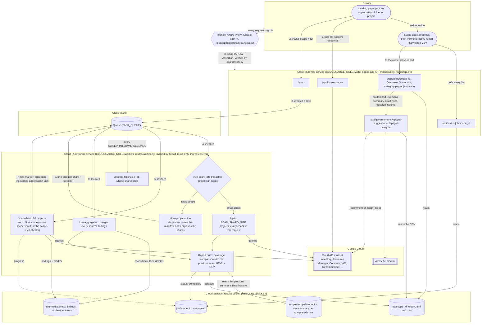
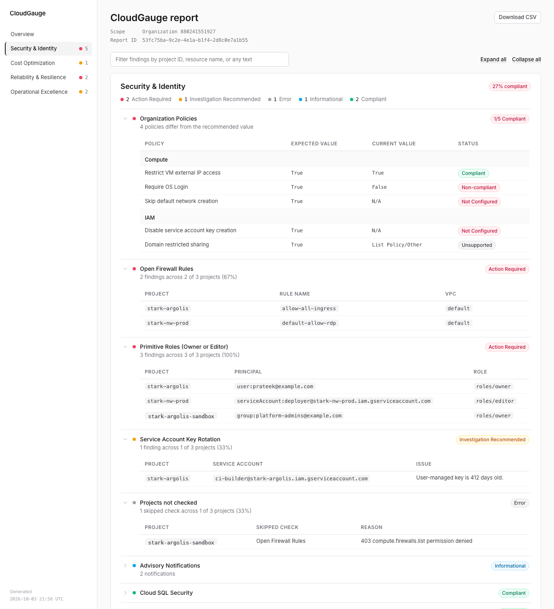
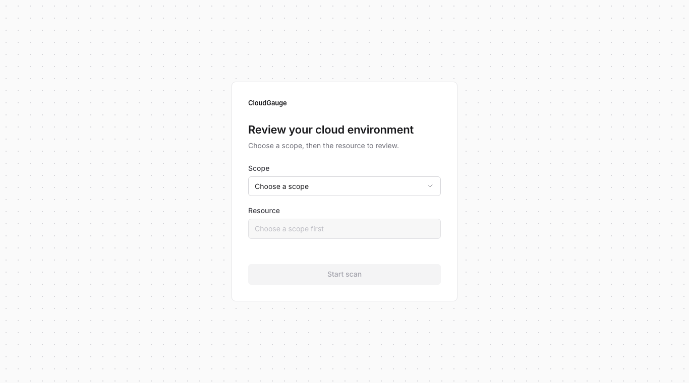
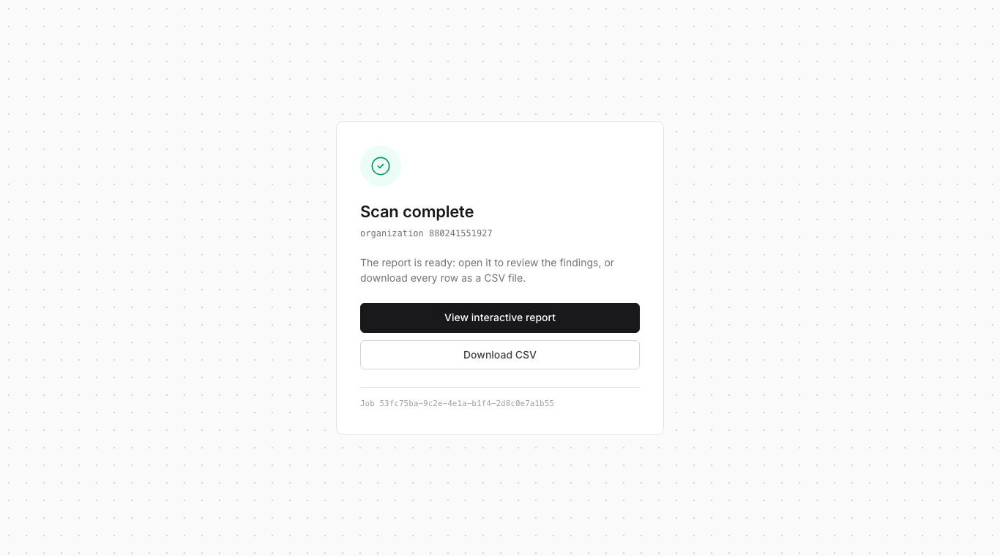

# Architecture

How a scan runs — the two Cloud Run services, Cloud Tasks, the sharded path a large scope takes, the results bucket — what the report does with the result, and the layout of the repository. Deploying it: [operations.md](operations.md); the sizes, variables and names as a contract: [stability.md](stability.md).

In this page: [Architecture Diagram](#architecture-diagram) · [Scaling to Large Organizations](#scaling-to-large-organizations) (and [Sizing for your organization](#sizing-for-your-organization)) · [Reports for Large Organizations](#reports-for-large-organizations) · [The Pages](#the-pages) · [Project Structure](#project-structure)

The application follows a robust, scalable, and asynchronous "fire-and-forget" pattern, and everything it reads and writes stays in your project (see [Privacy & API Attribution](security.md#privacy--api-attribution)). This ensures the user gets an immediate response while the heavy work (which can take many minutes) is done in the background. The same flow serves a single project and an organization with thousands of projects; the difference is only in how the work is split behind the scenes. Three Flask blueprints make up the application: the **pages** (`app/routes/ui.py`), the **API** the pages call (`app/routes/api.py`), and the **worker** endpoints that only Cloud Tasks invokes (`app/routes/worker.py`). The recommended deployment runs them as **two Cloud Run services from one image**, told apart by `CLOUDGAUGE_ROLE`: the **web service** (`web`: the pages and the API) sits behind **Identity-Aware Proxy**, so opening it means signing in with a Google account that was granted access, and the **worker service** (`worker`) is reachable by Cloud Tasks alone (see [Deployment Instructions](operations.md#deployment-instructions)). `CLOUDGAUGE_ROLE=all` runs everything on one service, as every release before v16 did.

1.  **Signing in and choosing the scope**: Identity-Aware Proxy asks for a Google sign-in and lets through the accounts that were granted access; the landing page's header says who is signed in. The page offers three scopes — **organization**, **folder** or **project**. Choosing one calls `/api/list-resources`, which lists the *active* folders or projects of the organization the service runs in (one Cloud Asset Inventory search); folders are named by their path and ID (`Engineering / Platform (4711)`), since folder names are unique only among siblings, projects by `Display name (project-id)`. The user picks one from the list.
2.  **Task creation**: The `/scan` endpoint creates a **Cloud Task** with the scope, its ID, a fresh job ID and who asked for the scan (the identity IAP attached to the request, verified by `app/identity.py`; the report shows it as *Requested by*), and redirects the user to the status page. The task is named after the job (`scan-<job id>`, v20) and a transient Cloud Tasks answer is retried for up to 30 seconds, so a retry can never start a scan twice; if the queue still will not take it, the page says **Scan not queued** (503) and nothing was started, and while the scope's previous scan is still running the answer is **Scan already running** (409, v18.6.1) with that scan's status page. A **Cloud Scheduler** job (v17, `SCHEDULES` on `tools/deploy.sh`) does the same through the worker's `/scheduled-scan`, as the service account, with *Requested by* `schedule: <name>`.
3.  **Background worker**: Cloud Tasks invokes the `/run-scan` endpoint of the worker service in the background, with an OIDC token of the service account — the only identity allowed to invoke it; `--ingress internal` keeps the internet out even with a token. The worker lists the active projects in scope (Cloud Asset Inventory's recursive search; a folder scan also asks Resource Manager for the folder's direct children and reconciles the two lists, so a project moved in minutes ago is scanned too) and decides:
    * **Up to `SCAN_SHARD_SIZE` projects (default 20)**: it runs the whole scan in this one request.
    * **More projects**: it becomes a **dispatcher**. It writes the job's *manifest* (which projects belong to which shard), enqueues one `/scan-shard` task per shard of `SCAN_SHARD_SIZE` projects plus one **scope shard** for the checks that look at the scope itself (Organization Policies, Resilience of Critical Assets over the scope's Asset Inventory, Snapshot Sprawl and Cloud SQL Extended Support (v17), the SSRF-chain checks of v17.1, Essential Contacts and Data Access Audit Logs (v18.1), GKE Upgrade Readiness and GKE Observability (v18.2), the five network-edge checks of v18.3, the five data-governance checks of v18.4, VM Service Accounts, VM Hardening, Service Account Privileges and External Principals of v18.5, Serverless Exposure, Serverless Service Accounts, Cloud Armor Policy Content, SSL Certificate Health and Container Scanning Enabled of v18.6, Folder Primitive Roles, Secret Access Scope and Secret Manager Posture of v18.7, Spend Briefing, Spend Anomalies and Serverless Cost Hygiene of v18.8, Audit Log Pipeline, Duplicate Log Routing and Synthetic and SLO Coverage of v18.9, SCC Active Findings and Exposed Privileged VMs of v19, Platform Footprint (v19.1), Support Cases and Case Hygiene (v19.2), Organization Policy Exceptions and Bucket Logging (v19.3), the scope half of the split checks — the firewall-policy half of Open Firewall Rules, the organization-and-folders half of Privileged Grants, the organization half of Custom Roles With IAM Powers, the scope's own recommendations of IAM Least Privilege and the scope's own log entries of Service Account Activity Signals — and, in an organization scan, org IAM, SCC, audit logging, the organization's recent-change insights with Unattended Projects, and the organization's Advisory Notifications; the rule is that a check is scope-level when it takes the scope rather than the project list, `SCOPE_LEVEL_CHECKS` and `SPLIT_CHECKS` in `app/checks/registry.py`), schedules a *sweeper*, and returns within seconds.
4.  **Parallel processing**: Each shard executes its checks concurrently using a thread pool (`app/checks/runner.py`) under a time budget (`SHARD_TIME_BUDGET_SECONDS`). Every finding is written to an intermediate file in GCS as soon as it is found. Cloud Tasks runs up to `SCAN_MAX_CONCURRENT_SHARDS` shards at a time and retries a failed shard; a shard that fails on its last attempt records its checks as error rows so one bad shard never costs the whole report.
5.  **Automatic fan-in**: When a shard finishes it writes a *marker* file. The shard that sees a marker for every shard enqueues the `/run-aggregation` task. The task name is deterministic (`<job>-aggregate`), so when two shards finish together Cloud Tasks accepts only one; nothing is counted, nothing needs a database. The `/sweep` task runs every `SWEEP_INTERVAL_SECONDS` as a safety net: it gives shards whose task has vanished error rows and finishes the job, so a scan always terminates.
6.  **Report build**: The single task, or the aggregation, reads the findings back (one item per check, with a **coverage** line stating how many projects were scanned), reads the **previous scan's summary** of the same scope from the bucket's `scopes/` prefix and compares the two (the report's *since* line and its deltas), with `BIGQUERY_DATASET` set loads the scan into BigQuery (v17, [History and analytics](history-and-export.md#history-and-analytics)) and states the outcome in the header, renders the HTML and CSV reports, uploads them to Google Cloud Storage, files this scan's own summary under `scopes/` for the next scan to find, and deletes the intermediate files.
7.  **Status and report pages**: The status page polls `/api/status/<job>/<scope_id>` every few seconds; for a sharded scan it shows *"Scanned 640 of 1,000 projects · organization-level checks: completed"*. When the job completes it offers **View interactive report** (`/report/<job>/<scope_id>`, the HTML served from the bucket by the service) and **Download CSV** (`/report/<job>/<scope_id>/csv`, streamed from the bucket by the service, behind the same sign-in as every other page). The report's on-demand features call the API from its pages: the Scorecard's executive summary (`/api/get-summary`, Gemini over the CSV in the bucket), the Overview's **Draft fixes** (`/api/get-suggestions`, Gemini) and the Cost Optimization page's **Get detailed insights** (`/api/get-insights`, the Recommender's insight types). Shards are an implementation detail: everything the user reads (status page, coverage line, error rows) speaks of projects and organization-level checks.

## Architecture Diagram

The diagram below shows the whole flow: Identity-Aware Proxy in front of the web service's pages and API, the worker service with the sharded path a large scope takes, the results bucket, and the report's on-demand features.



## Scaling to Large Organizations

A single request scanning 1,000 projects used to hang, run out of memory, or trip API quotas, and recovering meant a separate "aggregate" step. Sharding removes the ceiling without changing the user's workflow:

* **Bounded work per request.** A shard holds `SCAN_SHARD_SIZE` projects (default 20) and has `SHARD_TIME_BUDGET_SECONDS` (default 20 minutes) for its checks; checks that do not finish in time are reported as errors for that shard, the rest of the shard is kept. Each shard task has a 30-minute Cloud Tasks dispatch deadline, so set the Cloud Run request timeout to at least `1800` (the instructions use `3600`).
* **Bounded load on the APIs.** The queue created at startup allows `SCAN_MAX_CONCURRENT_SHARDS` (default 25) concurrent dispatches, 3 attempts per task, and 30 s–10 min back-off. If the queue already exists with different limits, the service logs a warning with the `gcloud tasks queues update ...` command to apply them (it never changes an existing queue by itself).
* **Spread across instances.** Deploy the service with a low request concurrency (the instructions use `--concurrency=4`) so that a burst of shards is spread over several Cloud Run instances instead of piling onto one.
* **Always terminates.** Markers in GCS plus deterministic task names make the fan-in exact and idempotent: retried or duplicated deliveries re-check the markers and never aggregate twice. A shard that crashes on every attempt is caught by the sweeper (`SWEEP_INTERVAL_SECONDS`), and the report is delivered with that shard's checks as error rows and an amber coverage line. A job that is still running at its **time limit** is finished with the results it has; the limit is sized per job (see below), so a large organization is never cut off while its shards are merely waiting in the queue. Partial reports are deliberate: an organization-wide report with 980 of 1,000 projects beats no report.
* **Same report.** The merged report is the one a single-task scan would have written for the same organization (the test suite verifies this against the synthetic organization), plus the coverage line.

The sizes can be tuned per deployment (see [Configuration Reference](stability.md#configuration-reference)); `tools/synthetic_scan.py --shard-size 20` rehearses the whole flow offline (see [Load Testing](operations.md#load-testing-with-a-synthetic-organization)).

### Sizing for your organization

There is no cap on the number of projects: discovery pages through the whole organization, the job gets `ceil(projects / SCAN_SHARD_SIZE) + 1` shards, and the report's page size is bounded by the per-check row cap, not by the project count. What grows with the organization is the **duration** and the **API load**:

* **Duration.** The queue runs `SCAN_MAX_CONCURRENT_SHARDS` shards at a time, so a scan takes about `shards / SCAN_MAX_CONCURRENT_SHARDS × (time per shard)`, in waves: deployed on Cloud Run with 150 ms per API call a 20-project shard takes 5–6 minutes (measured for v20; the in-process harness says 8, sharing one interpreter between its shards). Count the scope shard: 500 projects are 26 tasks, so at 25 concurrent the 26th waits for a slot and the scan takes two waves (11 minutes) instead of one — `SCAN_MAX_CONCURRENT_SHARDS=26` or `SCAN_SHARD_SIZE=21` would have made it one. Real shards vary with the projects' contents.
* **The scope shard.** The organization-level checks — the effective organization policies and the exceptions below them, the resilience assets, the organization's IAM, log routing, SCC — run in one task whose work grows with the organization, not with the shard: 8 minutes at 500 synthetic projects, 17 at 1,000. It runs under the same `SHARD_TIME_BUDGET_SECONDS` (20 minutes by default, 30 at most — Cloud Tasks' dispatch deadline), stops starting new checks when the budget is spent, and the report says so: the coverage line reads *organization-level checks timed out* and the checks that did not run are listed as errors in their category, nothing is passed silently. Past a couple of thousand projects raise `SHARD_TIME_BUDGET_SECONDS=1800`; splitting the scope shard into one task per organization-level check group is on the [roadmap](roadmap.md).
* **API load.** A project costs about 180 API calls (measured on the synthetic organization: 61% of them Recommender `insights.list` / `recommendations.list`), so 25 concurrent shards with 15 check threads each can have a few hundred calls in flight (385 at the peak of the 500-project run). Compare that with the organization's quotas for the Recommender, Compute, Asset, and Monitoring APIs before raising `SCAN_MAX_CONCURRENT_SHARDS`; lower it if scans report `429` errors.
* **Time limit.** `max(6 h, 2 × ceil(shards / SCAN_MAX_CONCURRENT_SHARDS) × 30 min)`: twice the time the queue needs if every shard used its full dispatch deadline, and never less than 6 hours. The dispatcher logs it (`Dispatched 10,000 projects in 501 shards (501 tasks created); time limit 21.0 h.`); `SCAN_TIME_LIMIT_SECONDS` replaces it.

| Projects | Shards (20 each) | ≈ Duration at 25 concurrent | ≈ Duration at 100 concurrent | Time limit (25 / 100) | Report (HTML / CSV) |
|---|---|---|---|---|---|
| 500 | 26 | **11 min (measured, deployed)** | 8 min (the scope shard) | 6 h / 6 h | 12 MB / 11 MB (29k rows) |
| 1,000 | 51 | **17.5 min (measured, deployed)** | 17 min (the scope shard) | 6 h / 6 h | 22 MB / 22 MB (58k rows) |
| 5,000 | 251 | 1.1 h | 30 min (the scope shard's budget) | 11 h / 6 h | 54 MB / 110 MB (290k rows) |
| 10,000 | 501 | 2.1 h | 36 min | 21 h / 6 h | 57 MB / 210 MB (561k rows) |
| 50,000 | 2,501 | 10 h | 2.6 h | 101 h / 26 h | not measured for v20 |

The durations are waves × 6 minutes, or the scope shard when it is longer; the deployed ones were measured on the `v20.0.0-rc.2` image with the worker's settings (2 GiB, `--concurrency=4`), every project covered, no shard error — see [operations.md](operations.md#load-testing-with-a-synthetic-organization). The report sizes are from `tools/synthetic_scan.py --projects N --shard-size 20 --concurrency 25 --latency-ms 0` runs for v20 (the 500- and 1,000-project reports the deployed scans produced are the same size): the HTML flattens out because each check's table is capped at 2,000 rows, the CSV always holds every row. All completed with every project covered and no retries; the dispatcher created the 501 tasks of the 10,000-project run in 0.1 s, and merging its shards into the report took a minute. In that run the scope shard, sharing one interpreter with 25 project shards, spent its 20-minute budget before the last organization-level check ran — the report's coverage line said *timed out* and listed the check as an error; deployed, each shard has its own instance, and the 1,000-project scope shard finished in 17 minutes.

> **Rule of thumb.** For more than about 5,000 projects, raise `SCAN_MAX_CONCURRENT_SHARDS` (and, if needed, the organization's API quotas) until the scan fits the time you have; the worker service's `--max-instances × --concurrency` must cover the value (the deployment instructions leave Cloud Run's default of 100 instances and set `--concurrency=4`: 400).

## Reports for Large Organizations

A report for 1,000 projects can hold tens of thousands of finding rows. The HTML report keeps one page per category (findings are not grouped by project, which would make hundreds of groups) and makes that page usable at scale:

* **Worst first.** Within each category the checks are ordered Action Required → Investigation Recommended → Error → Informational → Compliant, then by name, and a strip under the category heading counts the checks in each status.
* **How a score is computed.** A category's score is the share of its checks that reached a verdict and were compliant: `compliant / (compliant + Action Required + Investigation Recommended)`, banded above 90 (green, *Healthy* on the Scorecard), above 70 (amber, *Needs attention*) and otherwise red (*At risk*). A check in **Error** — including the *Projects not checked* item — is coverage, not a verdict: it is stated next to the score ("7 of 12 checks compliant · 1 could not be checked", on the Review scores table and the Scorecard) and never inside it, so a transient API failure in one scan does not move the score between scans. The briefings (Informational) are outside the score as well. **Organization Policies** is one check worth `compliant policies / total policies` of a pass ("18 of 128 policies as recommended"), so a long policy list cannot outweigh the checks; the count cards count it once too. A category in which no check reached a verdict is **Not assessed** — no number, no band — rather than 100%. Each cost recommender is a check: it is Compliant when it answered in at least one project and had nothing to recommend ("No idle persistent disks found."), Action Required when it recommended something, and absent when nobody could ask it. The rule lives in `app/reporting/scoring.py` and has its own tests (v15.2).
* **A summary line per check.** Tables open with "1,204 findings across 312 of 1,000 projects (31%)" (the share needs the scan's project count, which organization and folder scans record), so the scale of a finding is clear before reading any rows.
* **Paged, sortable, filterable tables.** Tables show 50 rows at a time ("Show 50 more" / "Show all"), any column header sorts, and the filter box at the top of each category page keeps only the rows (and checks) that mention a project ID, bucket name, or any other text (the Overview has no findings to filter, so it shows only the CSV link). Everything is inline, vanilla JavaScript: the report stays a single self-contained file.
* **No blank pages.** Every category has a page, whatever the scan found. A category none of whose checks reported anything says "Not assessed — no Cost Optimization check reported a result in this scan" (its score is *Not assessed*, not 100%), and a page whose checks are all hidden by the filter says so and how many matching checks are on other pages. A check that fails outright is listed as an error in its category, and a check that could not cover some projects says so (next bullet), so an empty category is one none of whose checks reached a verdict.
* **"Projects not checked" instead of silent passes.** A per-project check skips a project whose API call fails (a missing role, a disabled API, a quota, a transient error) rather than stop the scan. Those skips are not silent: each category page lists at most one **Projects not checked** item, with status Error, holding a `Project | Skipped check | Reason` table of every project a check of that category could not cover and the API's message (filterable by project ID like any other table; the CSV has the same rows). A project in which the API that owns the resources is not enabled (no Compute Engine API, so no firewall rules or VMs) has nothing to check and is left out; a disabled Recommender or Monitoring API is reported, since the project may well have the resources. Cost-Saving Recommendations and Network Insights are queried at the zones and regions discovered from the scanned projects' compute resources, so a project whose discovery failed is reported too: "all 8 recommenders: no zones or regions were discovered to query" when nothing could be queried for it, or "queried only in zones and regions found in other projects" when it was. When the item is present, a Compliant check on that page is compliant for the projects it could read; the projects in this table were not looked at by the check named next to them.
* **Briefings: Google's messages, outside the score — and, since v17.3, off the Scorecard.** The Stability line no longer tallies the Service Health briefing (it used to read *42 incidents impacted you in 90 days*, a count of mostly *Related* rows on the executive page) and the executive summary never sees it; what the Scorecard says about incidents is **Incident Exposure**'s row count, the customer's own finding. Two items were the first *briefings* rather than checks: **Service Health Incidents** (Reliability) and **Advisory Notifications** (Security). They list what Google told the customer — incidents that touched the scanned projects, Mandatory Service Announcements, advisories, sensitive-action digests — and are always *Informational*: they never count as compliant or non-compliant and do not move a category's score. Each is one table for the whole scan, one row per incident or notification naming every project it concerns (never one row per project), newest and active first. What *is* scored is whether the customer can receive these messages at all: **Personalized Service Health API Coverage** (a project without the Service Health API) and **Advisory Notifications Settings** (a notification type turned off, or settings the scanner cannot read). Later releases added briefings of the customer's own estate with the same standing — **Capacity Commitments** (v17), **Recent Changes**, **Spend Briefing** (v18.8), **Platform Footprint** (v19.1) and **Support Cases** (v19.2): *Informational*, outside the score, never compared between scans.
* **Bounded page size.** A table holds at most 2,000 rows in the page; a note under it says how many were left out and links to the complete list. The CSV report always has every row and can be downloaded at any time from `/report/<job_id>/<scope_id>/csv` — the status page's button and the report header's **Download CSV** are that same route, streamed from the bucket by the service, so neither expires.
* **Bounded prompts.** The AI executive summary is generated from at most 25 rows per check (plus the row counts), and a remediation prompt from the first 25 rows of a finding, so Gemini calls stay within their input limits however large the scan.
* **One remediation block per failing finding.** A check that knows its fix (Personalized Service Health API Coverage, Advisory Notifications Settings, Essential Contacts and GKE Supported Versions were the first; since v18 nearly every check carries a `Fix`) shows it in a **Fix** block right under its table — the exact `gcloud` command or console step, one line per distinct fix — rather than in a column repeated on every row. For every other Action Required or Investigation Recommended finding, **Draft fixes** asks Gemini and puts the answer in the same place, labelled *Suggested fix (AI-generated)*; checks that already show a fix are not sent to Gemini. Each block has a **Copy** button. The CSV keeps `Fix` as a column, and the Scorecard's Top actions tag such a check *fix in report*.
* **Changes since last scan.** Every finished scan files a small summary of itself under `scopes/<scope>/<scope id>/` in the results bucket (the release that wrote it, its scores, counts, each check's status and the identity of every row that needs work), and the next scan of the same scope compares itself with the newest one: the header names the **Previous scan** (with a link to it), each count card says how it moved, a **Changes since last scan** card on the Overview gives each category's score delta, the rows resolved and new, and its status changes ("Public GCS Buckets Compliant → Action Required"), each check whose rows changed carries a chip ("+3 new · −5 resolved"), rows the previous scan did not have are marked **New**, and the rows that disappeared are listed under the table ("Resolved since last scan"). The CSV gains a trailing `New since last scan` column (`yes` or empty) so an action plan can be filtered on it. Two rows are the same finding when they match on every column that is not a measurement (numbers and dates are left out, as is `Fix`) with the digits in prose cells ignored, so a re-estimated saving or a reworded count does not become a new finding. A check that errored in either scan is *not compared* (an Error scan did not look, so nothing was resolved). A check whose rows cannot be compared with a scan by an older release — its rows changed shape (Disk Snapshot Resilience in v15.6) or its rule changed (since v16.1 a snapshot in a multi-region passes) — has its status compared but not its rows, *not compared (rows changed)* or *(rule changed)*, since every row would read as new and every old one as resolved, or a snapshot nobody touched would read as fixed; the next scan compares as usual. A check the previous scan had no result for is read by the release that wrote each summary: when both scans are by the same release there was nothing to check then (an empty folder that has its first project now), so every row that needs work is new — counted, marked **New**, "no result → Action Required" on the card; when the previous scan was by another release the check may be new to this one, so it is *not compared (new check)* rather than "all new". A check the previous scan had and this one does not is listed once on the card ("No result in this scan" within a release, "No longer checked" across releases), and the briefings are never compared. The previous scan's scores and counts are recomputed from its checks under the current scoring rule rather than read from its summary, so a change of rule never shows as a change of posture; a category not assessed in either scan shows no delta. Synthetic scans neither compare nor enter the history. Rules and format: `app/reporting/changes.py`.
* **Readable tables, nothing cut.** Cells wrap at word boundaries (never mid-word), short columns — dates, states, IDs, counts — stay on one line, a table wider than the page scrolls sideways instead of squeezing, and a plain cell longer than a few lines is clamped to three with a *Show more* toggle. The two briefings have their own layouts: an incident row is `State | When (UTC) | Incident | Products | Projects | Relevance | ID` (start and end stacked, the locations as a muted line under the title, a long project or location list as a count that opens on click) and a notification row is `Date | Type | Notification | Details` (the message under its subject, clamped to three lines with *Show full message*; attachments and digest actions as a list). Nothing is shortened at the source: every location, every attachment row and the whole message are in the page (sortable and filterable, text behind a disclosure included) and in the CSV, whose columns are the raw ones.

The caps live in `app/reporting/context.py` (`MAX_ROWS_PER_CHECK`, `ROWS_PER_PAGE`), `app/reporting/layouts.py` (the layout rules and their thresholds) and `app/services/gemini.py` (`SUMMARY_ROWS_PER_CHECK`, `REMEDIATION_MAX_CHARS`).

## The Pages

CloudGauge has five screens: three redesigned in v14.2 around one small design system (`app/templates/_design.css`, inlined into every page so a stored report never depends on a stylesheet served later), the Scorecard, added in v15.1 on the same system, and the history page (v17); the two pages that answer a scan that cannot start — **Scan already running** (409, v18.6.1) and **Scan not queued** (503, v20, with a **Try again** button) — use it too:

* **Setup and status** — one centred card on a dot-grid canvas. The setup card is the scope and resource selects and one black **Start scan** button; the status card shows a thin progress bar and the current task while the scan runs, then **Scan complete** with **View interactive report** and **Download CSV** (or **Scan failed** with the last message).
* **The report's Overview** — the operator's working page. A fixed sidebar (each category with the colour of its worst status and the number of items that need a human, and when the report was generated and by which release), a header that states the scope, the report ID, the **Coverage** ("312 of 312 projects · organization-level checks completed"; amber with a note under the count cards when a sharded scan did not finish everything), in a folder scan a **Folder membership** row only when Cloud Asset Inventory and Resource Manager disagree about which projects are in the folder (see [How to Use](operations.md#how-to-use)), and the **Previous scan** (a link, or "none — first scan of this organization"), with **Download CSV** and **Print or save as PDF** beside them (v20: the whole report through the browser's print dialog, the Scorecard first, then the Overview and each category on its own sheet, every accordion open), four count cards with how each moved since that scan, the review scores as bars, the **Changes since last scan** card when there is a previous scan, and the **Suggested fixes** card (powered by Gemini) with **Draft fixes**; the status line under it reports where the drafted fixes landed ("Suggested fixes added to 12 findings: Security & Identity (5) · Cost Optimization (7)") and offers **Try again** after an error.
* **The report's Scorecard** — the one-pager for the people who will not open the category pages: a quarterly review, a leadership update. Four **stoplights**, one per pillar over one report category (Stability over Reliability & Resilience, Security over Security & Identity, Operations over Operational Excellence & Observability, Efficiency over Cost Optimization), each a three-lamp light that reads in monochrome, the category's score with its delta, a state in the bands the score bars already use (above 90 **Healthy**, above 70 **Needs attention**, else **At risk**; **Not assessed**, with no lamp lit and a dash for the score, when no check in the category reached a verdict) and the evidence behind it ("22 of 24 checks compliant · 1 could not be checked · 3 projects with findings · 3 assets without failover in locations that had incidents"; the Efficiency line adds the spend and the identified savings). Under them a **since line** — new and resolved findings, the first three status changes and a link to the rest on the Overview, or "First scan of this organization — changes appear from the next scan". **Top actions** lists the ten failing checks ranked by status, then projects affected, then findings (the table says so, and shows all three), each linking to its finding and tagged *fix in report* when the check ships its own command (the other failing checks get a drafted fix from Gemini on the Overview); its footers give the Organization Policies tally, the checks that could not run, and how many more failing checks the category pages hold. Last, the **Executive summary** card, where **Generate executive summary** asks Gemini; the summary is labelled *AI-generated* and has a **Copy** button. Three outline buttons at the top: **Print** (the Scorecard alone, on one A4 page), **Download action plan (CSV)** (the ranked actions with `Findings` and `Fix in report` columns and blank `Owner` and `Target date` columns to fill in) and **Copy as Markdown** (stoplights, since line, actions, and the executive summary once generated). Everything on the page is built from the same report context, so it states nothing the category pages cannot back (`app/reporting/scorecard.py`).
* **A category page** — the checks as accordions, worst first. Each row is a status dot, the check's name with its one-line summary ("1,204 findings across 312 of 1,000 projects (31%)"), a status pill and, after a previous scan, a change chip ("+3 new · −5 resolved", or "not compared"); on load the items that need a human (Action Required, Investigation Recommended, Error) are open and the Compliant and Informational ones collapsed. Rows the previous scan did not have carry a **New** marker (generated by CSS, so it is never part of the row's text for sorting, filtering or the CSV), and the rows it had and this scan does not are listed under the table. **Expand all** / **Collapse all** sit next to the filter box, and a `#<section>-<check>` link opens that one check.
* **The history page** *(v17)* — `/history/<scope>/<scope id>`, linked from the report header's **History** row, the status page's **View history** and the setup page once a resource is chosen: the scope's scans over time from the summaries filed under `scopes/`. The four pillar scores as monochrome lines (inline SVG, one dash pattern per pillar, no script), then one row per scan — when, who asked (a person, or `schedule: weekly-org`), the release, the project count, the four scores, the four Overview counts and the checks whose status changed since the scan before — each linking to its report. Scores are recomputed from each scan's check statuses under the current rule, as *Changes since last scan* does.



The rules, which `tests/test_design.py` holds the templates to:

| Rule | In practice |
|---|---|
| Separation is a 1px border, never a shadow | `border: 1px solid` zinc-200 on cards, the sidebar, each accordion row; no `box-shadow` anywhere |
| A quiet canvas, white content | page background zinc-50, cards and table rows white |
| One high-contrast primary action | the black (zinc-900) button: *Start scan*, *Generate executive summary*, *View interactive report*; everything else outlined or a text link |
| Status is a dot and a soft pill, in a semantic colour | rose = Action Required, amber = Investigation Recommended, emerald = Compliant, zinc = Error, sky = Informational; each pill is a pale fill, a one-shade-darker border and dark text of its hue — never raw red or green |
| Inter for text, monospace for anything a machine would read | project IDs, principals, instances, incident IDs, dates, counts, scores, the report ID and the job ID are monospace (`code`-styled chips for resources); the four KPI numbers are the one exception, set light in Inter with tabular figures |
| Dense, quiet tables | no vertical rules; uppercase, letter-spaced, zinc-500 headers; a hairline under each row; a row hover; tight cell padding |
| Sentence-case copy | "Review your cloud environment", "Scan complete", "Generate executive summary"; status and category names keep their capitals |

<p align="center"> </p>

## Project Structure

The application is a Flask package built by an application factory (`create_app()` in `app/__init__.py`). The root `cloudgauge.py` is a thin entrypoint that exposes `app = create_app()`, so the container command (`gunicorn ... cloudgauge:app`) is the same as before the refactor.

```
cloudgauge.py            # Entrypoint for gunicorn / Cloud Run: app = create_app()
run.py                   # Local development server (see Local Development & Testing)
app/
├── __init__.py          # create_app(): settings, startup checks, blueprints
├── config.py            # Settings read from environment variables; profiles; the release (VERSION)
├── extensions.py        # Shared, lazily created clients and the resolved worker URL
├── identity.py          # Who is signed in (IAP's assertion, verified) and who is calling the worker (the service account's ID token, v18.6.1)
├── validation.py        # The shapes of scope, scope ID, job ID and the task bodies; every route validates with it (v18.6.1)
├── utils.py             # Shared helpers: backoff on HTTP 429, the throttled progress reporter, the clock the checks judge ages by
├── scan_job.py          # Background scan: run checks -> build reports -> upload -> clean up (or dispatch shards)
├── fanout.py            # Sharded scans: dispatcher, shard worker, marker fan-in, aggregation, sweeper
├── routes/              # Blueprints
│   ├── ui.py            #   /, /scan, /status/..., /report/..., /history/<scope>/<scope_id> (v17)
│   ├── api.py           #   /api/list-resources, /api/status/..., /api/get-summary, /api/get-suggestions, /api/get-insights
│   ├── worker.py        #   /run-scan, /scan-shard, /run-aggregation, /sweep (invoked by Cloud Tasks); /scheduled-scan (Cloud Scheduler, v17)
│   └── guards.py        #   Same-origin on the POST routes; the worker's caller check (v18.6.1)
├── checks/              # Checks grouped by pillar: security, cost, reliability, operations, network, capacity (v17), the SSRF chain (v17.1)
│   ├── registry.py      #   The check plan: which checks run, and in what order; SCOPE_LEVEL_CHECKS and SPLIT_CHECKS for sharded scans
│   ├── runner.py        #   Runs the plan concurrently (ThreadPoolExecutor) and reports progress
│   ├── categories.py    #   Maps check names to report categories; merges and folds the shards' records
│   ├── security.py      #   Organization Policies, org and project IAM, SCC status, keys, public buckets, firewall rules, Cloud SQL, VPC, UBLA, external IPs, IAM Least Privilege (v17)
│   ├── cost.py          #   Cost-Saving Recommendations (the recommenders), Cost Allocation Labels, Cloud Storage Lifecycle, Snapshot Sprawl (v17)
│   ├── reliability.py   #   Essential Contacts, Cloud Storage Versioning, GKE Hygiene, Resilience of Critical Assets, Cloud SQL Extended Support (v17)
│   ├── operations.py    #   Organization Log Sink, Data Access Audit Logs (v18.1), OS Config, Monitoring Alert Coverage, Standalone VMs, quotas, Recent Changes, Unattended Projects
│   ├── network.py       #   Network Insights: the Network Analyzer insight types
│   ├── service_health.py#   Service Health Incidents briefing + Personalized Service Health API Coverage (v14)
│   ├── advisories.py    #   Advisory Notifications briefing + Advisory Notifications Settings (v14)
│   ├── gke_versions.py  #   GKE Supported Versions: clusters and node pools on minors GKE no longer offers (v15)
│   ├── capacity.py      #   Capacity Commitments, Reservation Coverage, Commitments Expiring, Capacity Signals (v17)
│   ├── gke_security.py  #   GKE Credential Exposure, Control Plane Exposure, Node Hardening, Threat Detection — the SSRF chain (v17.1)
│   ├── impersonation.py #   Service Account Impersonation: who can become which service account, with reach (v17.1)
│   ├── perimeters.py    #   VPC Service Controls Coverage (v17.1)
│   ├── exposure.py      #   Incident Exposure: the assets without failover where an incident happened, derived from the scan itself (v17.3)
│   ├── gke_operations.py#   GKE Upgrade Readiness, GKE Observability (v18.2)
│   ├── network_edge.py  #   Hybrid Connectivity, Load Balancer Edge, DNS Posture, VPC Flow Logs, VPC Peering & Cloud NAT (v18.3)
│   ├── data_governance.py # BigQuery Governance, Cloud SQL Flags, AlloyDB Posture, KMS Keys, API Keys (v18.4)
│   ├── vm_hardening.py  #   VM Service Accounts, VM Hardening (v18.5)
│   ├── identity_hygiene.py # Service Account Privileges, External Principals, Unused Service Accounts (v18.5)
│   ├── serverless.py    #   Serverless Exposure, Serverless Service Accounts, Container Scanning Enabled (v18.6), Serverless Cost Hygiene (v18.8)
│   ├── edge_security.py #   Cloud Armor Policy Content, SSL Certificate Health (v18.6)
│   ├── privileges.py    #   Folder Primitive Roles, Privileged Grants, Custom Roles With IAM Powers (v18.7)
│   ├── secrets.py       #   Secret Access Scope, Secret Manager Posture (v18.7)
│   ├── spend.py         #   Spend Briefing, Spend Anomalies — the billing export in BigQuery (v18.8)
│   ├── log_cost.py      #   Log Cost Levers (v18.8)
│   ├── log_pipeline.py  #   Audit Log Pipeline, Duplicate Log Routing, Project Log Routing (v18.9)
│   ├── alerting.py      #   Alert Notification Channels, Synthetic and SLO Coverage (v18.9)
│   ├── scc.py           #   SCC Active Findings, SCC Detector Coverage — Security Command Center through REST (v19)
│   ├── vulnerabilities.py #  OS Vulnerabilities (VM Manager), Exposed Privileged VMs (v19)
│   ├── footprint.py     #   Platform Footprint — the inventory on one page (v19.1)
│   ├── detection.py     #   GKE Control Plane Activity, Service Account Activity Signals — 7 days of Admin Activity logs (v19.1)
│   ├── support.py       #   Support Cases, Case Hygiene — the open cases from the Cloud Support API (v19.2)
│   ├── org_policy_exceptions.py # Organization Policy Exceptions — every policy set under the scope, inheritance computed in memory (v19.3)
│   ├── bucket_logging.py #  Bucket Logging — usage logging × Data Access logs per project (v19.3)
│   └── not_checked.py   #   The projects a check could not cover, reported as "Projects not checked"
├── services/            # gcp.py (clients), tasks.py (Cloud Tasks: the queue, the named tasks, the v20 enqueue retry), results_store.py (the bucket: findings, status, reports, per-scope scan summaries, schedule notes), resource_manager.py (scope listing, projects in scope, folder membership reconciled with Resource Manager, v15.4), org_policies.py, gemini.py, insights.py, worker_url.py, bigquery_export.py (the scans' export, v17), schedules.py (scheduled scans and the one-scan-per-scope lock, v17), user_agent.py (the API attribution identifier, v18.8.1)
├── reporting/           # context.py (the view-model: checks grouped and scored, coverage, the caps), html_report.py and csv_report.py (the two reports); layouts.py lays out a check's table (v14.1); changes.py compares two scans (v15); scorecard.py builds the Scorecard page and its exports (v15.1); scoring.py is the score rule (v15.2); history.py builds the history page (v17)
├── synthetic/           # Synthetic load mode: a generated organization (world.py) behind the GCP client seam (provider.py), an in-memory results bucket (memory_store.py)
└── templates/           # _design.css (tokens and primitives every page inlines, v14.2), index.html, status.html, history.html (v17), scan_running.html (409, v18.6.1), scan_not_queued.html (503, v20), report/ (HTML, CSS, JS)
tests/                   # pytest suite (see Local Development & Testing)
tools/synthetic_scan.py  # Offline load test against the synthetic organization (see Load Testing)
tools/demo_gif.py        # Records the README's demo GIF from a scan on a deployed service (Playwright + Pillow, own venv)
tools/deploy.sh          # Deploys or updates the two services (worker, web behind IAP), the export dataset and the schedules, and grants access; see Deployment
tools/iap_token.py       # A token that passes IAP, for curl, scripts and demo_gif.py (service-account signed JWT)
tools/backfill_export.py # Loads the scans made before the BigQuery export existed, from their summaries and CSVs (v17)
tools/release_notes.py   # The release's section of RELEASE_NOTES.md — the body of its GitHub Release (v20)
terraform/               # The same deployment declared in Terraform (v17.2): the two services, IAP, the account and its roles, the bucket, the queue, the export, the schedules; see Method 3
assets/                  # gcp_best_practices.csv (the policy table) and cloud_armor_rulesets.json, both copied into the image; the README's images and the sample CSV
docs/                    # This documentation: architecture, checks, operations, security, stability, history-and-export, development, roadmap
VERSION                  # The release number — the one place it is written; app/config.py reads it, the image copies it (v20)
RELEASE_NOTES.md         # One section per release, newest first; the tag's section becomes its GitHub Release
Dockerfile               # Production image
Dockerfile.test          # Runs the test suite inside the production image
cloudbuild.yaml          # Cloud Build: build -> test -> push
.github/                 # workflows/ci.yml (the suite and the lint on Python 3.11 and 3.13, terraform fmt and validate, the container build with the suite inside it — every pull request and push to main), workflows/release.yml
                         # (a tag publishes the GitHub Release), dependabot.yml, CODEOWNERS, the issue and pull-request templates, rulesets/main.json (the branch rules of main) (v20)
SECURITY.md              # How to report a vulnerability — privately
requirements.txt         # Production dependencies (pinned)
requirements-dev.txt     # Adds pytest and ruff
```

**Adding a check:** write the function in the matching `app/checks/` module, add a `CheckSpec` entry to `app/checks/registry.py`, and map the names it reports to a category in `app/checks/categories.py`. If it skips projects whose API calls fail, collect them in a `NotChecked` from `app/checks/not_checked.py` and write it after the check's own record, so the report says which projects it did not cover. If the check knows how to fix what it finds, put the command in a `Fix` key of each row: the report shows the distinct fixes in one block under the table (not as a column) and leaves that check out of the Gemini remediation request; the CSV keeps the column.
